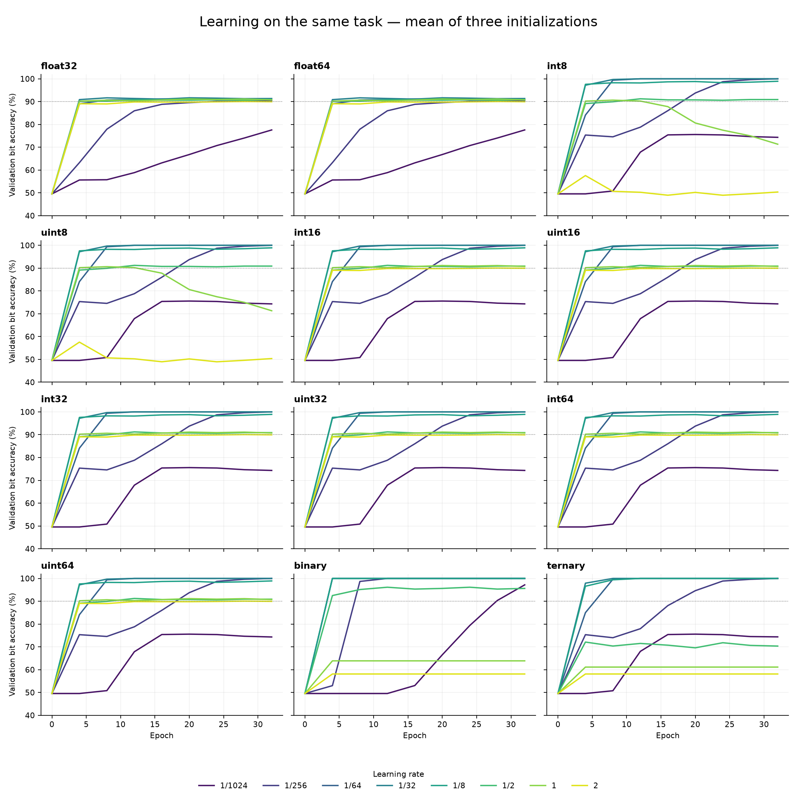
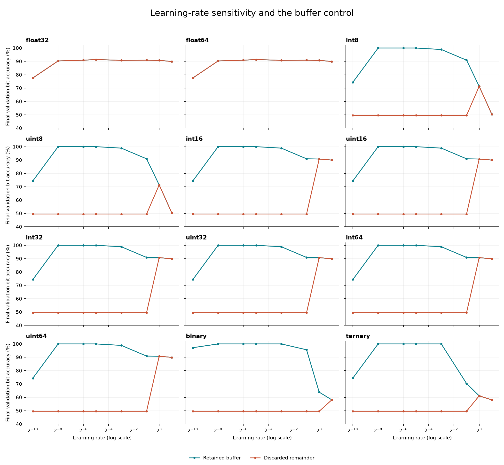

# Learning-rate sweep: native dense training

Measured 2026-09-12T13:39:50.438252+00:00 on Intel(R) Core(TM) i5-10400 CPU @ 2.90GHz; one thread, core 2.

**Same task for all 12 dtypes:** learn 16 binary classifiers from 16 bipolar inputs with one dense layer, no bias. A fixed binary teacher generates the same labels for every dtype. There are 256 training, 128 validation and 256 test examples, with no input overlap. Three shared initializations: [11, 22, 33]. Budget: 32 epochs (8,192 online steps).

**This is actual supervised training:** each example performs native forward, detects classification errors, computes native dX and dW, and updates mistaken output rows. Gradients are freshly recomputed. Each correct output has an explicit no-update control flag; binary gradients themselves remain packed ±1. Loss is the fraction of incorrect output bits; accuracy is one minus that loss.

A train-label-majority baseline scores **59.57% validation / 60.06% test**. The teacher itself scores 100% on every split.

Learning rates tested: **1/1024, 1/256, 1/64, 1/32, 1/8, 1/2, 1, 2**. “Best” means lowest mean final validation error across three initializations; ties prefer earlier validation 90% attainment, then smaller LR. Test results and wall-clock speed are excluded from selection. These are task/budget-specific choices, not universal rates for a dtype.

This task deliberately uses a binary teacher and labels exact zero scores as +1. Recovering discrete teacher weights suits it particularly well. The floating-point accuracy below is not evidence that floats are generally less capable.

## Best tested learning rate and held-out accuracy

| Dtype | Selected LR | Initial val % | Final train % | Final val % | Final test % | Seeds reaching 90% val |
|---|---:|---:|---:|---:|---:|---:|
| float32 | 1/32 | 49.54 | 94.68 | 91.34 | 91.81 | 3/3 |
| float64 | 1/32 | 49.54 | 94.68 | 91.34 | 91.81 | 3/3 |
| int8 | 1/32 | 49.54 | 100.00 | 100.00 | 100.00 | 3/3 |
| uint8 | 1/32 | 49.54 | 100.00 | 100.00 | 100.00 | 3/3 |
| int16 | 1/32 | 49.54 | 100.00 | 100.00 | 100.00 | 3/3 |
| uint16 | 1/32 | 49.54 | 100.00 | 100.00 | 100.00 | 3/3 |
| int32 | 1/32 | 49.54 | 100.00 | 100.00 | 100.00 | 3/3 |
| uint32 | 1/32 | 49.54 | 100.00 | 100.00 | 100.00 | 3/3 |
| int64 | 1/32 | 49.54 | 100.00 | 100.00 | 100.00 | 3/3 |
| uint64 | 1/32 | 49.54 | 100.00 | 100.00 | 100.00 | 3/3 |
| binary | 1/64 | 49.54 | 100.00 | 100.00 | 100.00 | 3/3 |
| ternary | 1/32 | 49.54 | 100.00 | 100.00 | 100.00 | 3/3 |

The three languages produce identical learning curves, final weights and residual bytes for each dtype/LR/initialization/control. Accuracy is therefore shown once; timing is shown per language.

## Training speed at the selected learning rate

Median milliseconds over the three initializations. Each timed training epoch includes forward, error calculation, both backward products and the conditional update. Evaluation, initial encoding, process startup and file I/O are excluded. Parentheses show median measured training time to first observed 90% validation accuracy, or “not all” if any seed misses it. Validation is checked every four epochs, so threshold times are coarse.

| Dtype | LR | Go ms (to 90%) | Rust ms (to 90%) | C++ ms (to 90%) |
|---|---:|---:|---:|---:|
| float32 | 1/32 | 8.41 (1.45) | 2.71 (0.37) | 2.13 (0.33) |
| float64 | 1/32 | 10.73 (1.99) | 3.33 (0.45) | 2.62 (0.39) |
| int8 | 1/32 | 11.35 (2.90) | 3.96 (1.23) | 4.91 (1.60) |
| uint8 | 1/32 | 10.60 (2.86) | 3.94 (1.24) | 4.94 (1.61) |
| int16 | 1/32 | 7.62 (2.64) | 3.71 (1.20) | 4.34 (1.46) |
| uint16 | 1/32 | 7.35 (2.58) | 3.73 (1.20) | 4.12 (1.42) |
| int32 | 1/32 | 8.30 (2.76) | 4.35 (1.28) | 4.12 (1.46) |
| uint32 | 1/32 | 8.24 (2.76) | 4.30 (1.39) | 4.46 (1.51) |
| int64 | 1/32 | 9.11 (2.67) | 4.69 (1.09) | 3.86 (1.05) |
| uint64 | 1/32 | 9.50 (2.82) | 4.57 (1.10) | 3.83 (1.04) |
| binary | 1/64 | 11.32 (3.11) | 3.50 (1.28) | 3.01 (0.75) |
| ternary | 1/32 | 13.74 (3.66) | 5.59 (1.41) | 4.71 (1.26) |

These are small-model end-to-end training measurements, not the earlier 256-wide kernel benchmark. Faster learning can reduce time spent in weight updates because correct outputs skip them. Raw results also include evaluation-inclusive wall time and per-checkpoint training times.

## What retaining the buffer changes

Same LR **1/32**, same examples, same initializations and same training budget; only retention of the integer/binary/ternary residual changes. Floating-point updates already accept fractional steps, so this control leaves them identical. Values are mean final validation accuracy.

| Dtype | Buffer retained % | Remainder discarded % | Improvement (percentage points) |
|---|---:|---:|---:|
| float32 | 91.34 | 91.34 | +0.00 |
| float64 | 91.34 | 91.34 | +0.00 |
| int8 | 100.00 | 49.54 | +50.46 |
| uint8 | 100.00 | 49.54 | +50.46 |
| int16 | 100.00 | 49.54 | +50.46 |
| uint16 | 100.00 | 49.54 | +50.46 |
| int32 | 100.00 | 49.54 | +50.46 |
| uint32 | 100.00 | 49.54 | +50.46 |
| int64 | 100.00 | 49.54 | +50.46 |
| uint64 | 100.00 | 49.54 | +50.46 |
| binary | 100.00 | 49.54 | +50.46 |
| ternary | 100.00 | 49.54 | +50.46 |

## Every LR, on the same task

Mean final validation accuracy, buffered training. Higher is better; learning curves below show how the models got there.

| Dtype | 1/1024 | 1/256 | 1/64 | 1/32 | 1/8 | 1/2 | 1 | 2 |
|---|---:|---:|---:|---:|---:|---:|---:|---:|
| float32 | 77.57% | 90.32% | 90.90% | 91.34% | 90.80% | 90.90% | 90.74% | 89.94% |
| float64 | 77.57% | 90.32% | 90.90% | 91.34% | 90.80% | 90.90% | 90.74% | 89.94% |
| int8 | 74.33% | 100.00% | 100.00% | 100.00% | 98.91% | 90.90% | 71.32% | 50.36% |
| uint8 | 74.33% | 100.00% | 100.00% | 100.00% | 98.91% | 90.90% | 71.32% | 50.36% |
| int16 | 74.33% | 100.00% | 100.00% | 100.00% | 98.91% | 90.90% | 90.74% | 89.94% |
| uint16 | 74.33% | 100.00% | 100.00% | 100.00% | 98.91% | 90.90% | 90.74% | 89.94% |
| int32 | 74.33% | 100.00% | 100.00% | 100.00% | 98.91% | 90.90% | 90.74% | 89.94% |
| uint32 | 74.33% | 100.00% | 100.00% | 100.00% | 98.91% | 90.90% | 90.74% | 89.94% |
| int64 | 74.33% | 100.00% | 100.00% | 100.00% | 98.91% | 90.90% | 90.74% | 89.94% |
| uint64 | 74.33% | 100.00% | 100.00% | 100.00% | 98.91% | 90.90% | 90.74% | 89.94% |
| binary | 97.18% | 100.00% | 100.00% | 100.00% | 100.00% | 95.62% | 63.87% | 58.11% |
| ternary | 74.38% | 100.00% | 100.00% | 100.00% | 100.00% | 70.35% | 61.13% | 58.11% |

## Arithmetic and scope

- All weights, input tensors, output tensors and gradient tensors use their requested dtype. Binary/ternary remain packed. Native integer products and sums wrap at their own width.
- The logical data are bipolar ±1. Unsigned −1 is encoded as the all-ones bit pattern; unsigned matrix arithmetic stays unsigned/modular. Classification interprets the resulting bit pattern as a same-width signed score. This is an explicit encoding convention, not a claim that unsigned numbers directly represent negative real values.
- The learning rule is an online, mistake-driven perceptron update: for a mistaken output, upstream direction is −target, and dW is computed by the real native outer-product kernel. For a correct output the optimizer skips its row. dX is also computed and kept observable, although this one-layer model does not need to propagate it further. This does not validate multi-layer binary backpropagation.
- Floats apply the dyadic LR directly in FP32/FP64. Discrete residuals use signed int64 Q16, so every tested LR is exact. Integer weight updates wrap, matching their matrix arithmetic. Binary/ternary updates saturate to their legal values, retain overshoot and discard outward endpoint residual. This experiment’s optimizer differs from the earlier saturating integer microbenchmark.
- At most one output-level control flag per classifier suppresses correct-example updates. There is no expanded floating-point gradient tensor or hidden full-precision weight copy. An unused int64 residual array is allocated in floating-point runs for a uniform driver layout; discrete residual state costs 8 bytes per weight.
- The buffered/unbuffered comparison tests this specific rule. A synthetic single-layer task is evidence of learning on that task, not a claim about image datasets, deep networks or universal learning rates.

[Full results, trajectories, dataset, compiler versions and hashes](results.json). [Reproduction and implementation](README.md).
